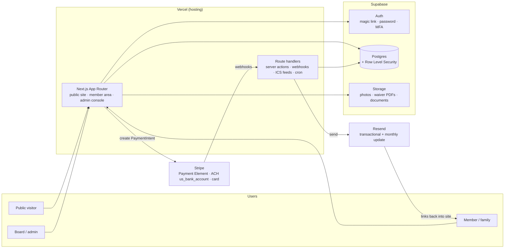
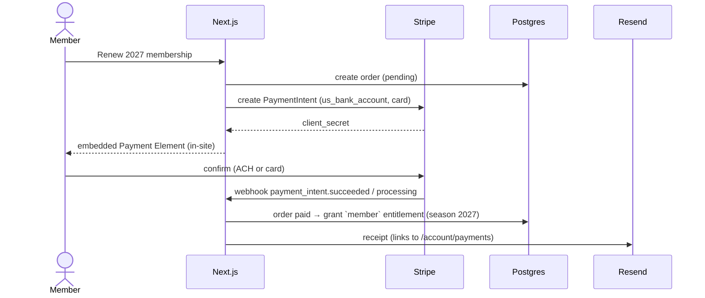
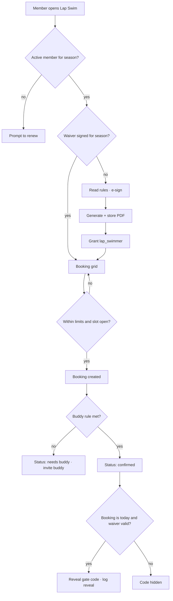
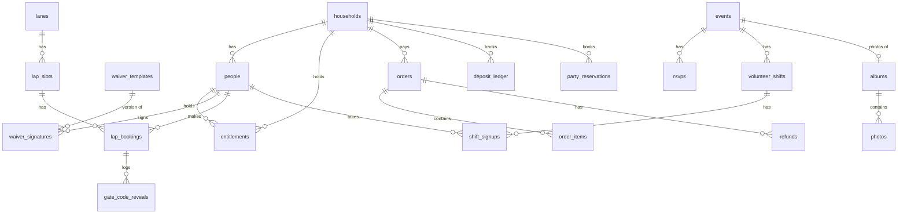

# Architecture: Las Trampas Pool v2

*Status: initial design, nothing built · October 2026*

> **Principles:** managed services only · one login · authorization in the database (RLS) · Stripe holds all payment data · email links back into the site · no member data in git.

---

## 1. High-level architecture



| Component | Responsibility |
|---|---|
| **Next.js (Vercel)** | Rendering, forms (server actions), Stripe intent creation, webhook handling, ICS feeds, scheduled jobs (Vercel Cron: reminders, season rollover checks, slot generation) |
| **Supabase Auth** | Identity. `auth.users` ↔ `people` (1:1) |
| **Postgres + RLS** | Source of truth; every table has RLS; helper functions answer "does this user hold role X for season Y?" |
| **Storage** | Buckets: `photos-public` (consented best-of), `photos-members` (private, signed URLs), `waivers` (private, admin + signer only), `documents` (members-only) |
| **Stripe** | Payment collection, receipts, refunds. Our DB stores only Stripe IDs and amounts |
| **Resend** | Magic-link email (via Supabase SMTP), receipts, reminders, monthly update sends |

**Environments:** `local` (Supabase CLI + Stripe test mode) → `preview` (Vercel preview + Supabase branch, test mode) → `production`. Secrets only in Vercel/Supabase settings.

---

## 2. Key flows

### 2.1 Payment → entitlement



ACH settles in a few days: an order in `processing` can grant provisional membership (board policy) and is revoked automatically on `payment_intent.payment_failed`.

### 2.2 Lap swim: waiver → booking → gate code



---

## 3. Initial data model

All tables have `id uuid pk`, `created_at`, `updated_at`. Money is integer cents. `season` is an integer year (e.g., `2027`) referencing `seasons`.

### 3.1 People & access

| Table | Key columns | Notes |
|---|---|---|
| `seasons` | `year`, `opens_on`, `closes_on`, `renewal_deadline`, `is_current` | Drives all expiries |
| `households` | `name`, `membership_type` (`full`, `lap_only`, …), `status`, `member_since` | |
| `people` | `user_id → auth.users` (nullable for young kids), `household_id`, `first_name`, `last_name`, `birth_year`, `kind` (`adult`,`teen`,`child`) | Minimal PII |
| `household_admins` | `household_id`, `person_id` | Who can manage the household |
| `contact_methods` | `person_id`, `type`, `value`, `verified` | Email/phone |
| `privacy_settings` | `person_id`, `directory_fields jsonb`, `photo_consent` (`ok`,`members_only`,`none`), `lap_buddy_visible` | |
| `roles` | `key` (`member`,`lap_swimmer`,`swim_team_family`,`volunteer`,`board`,`admin`) | Reference |
| `board_positions` | `key` (`president`,`treasurer`,`lap_swim_vp`,`social`,`membership`,`communications`,`webmaster`), `scopes text[]` | Scoped admin areas |
| `entitlements` | `person_id` or `household_id`, `role_key`, `scope` (nullable, e.g., board position), `season`, `source` (`payment`,`waiver`,`admin`,`import`), `source_id`, `starts_at`, `expires_at`, `revoked_at`, `revoked_reason` | **The** access table |
| `audit_log` | `actor_id`, `action`, `target_table`, `target_id`, `details jsonb` | Append-only |

### 3.2 Waivers

| Table | Key columns | Notes |
|---|---|---|
| `waiver_templates` | `key` (`lap_adult`,`lap_teen`), `version`, `season`, `body_md`, `body_sha256`, `requires_guardian`, `published_at` | Immutable once published |
| `waiver_signatures` | `template_id`, `person_id`, `guardian_person_id`, `typed_name`, `signature_png_path`, `signed_at`, `ip`, `user_agent`, `pdf_path`, `pdf_sha256`, `revoked_at` | Insert-only for signers |

### 3.3 Lap swim

| Table | Key columns | Notes |
|---|---|---|
| `lap_settings` | `season`, `max_per_week`, `max_advance_days`, `cancel_cutoff`, `buddy_mode` (`same_lane`,`same_slot`) | Board-tunable |
| `lanes` | `number`, `label`, `active` | 6 lanes |
| `slot_templates` | `season`, `weekday`, `start_time`, `end_time`, `lane_ids`, `capacity_per_lane` | Generates slots |
| `lap_slots` | `lane_id`, `starts_at`, `ends_at`, `capacity`, `blocked_reason` | Generated by cron/admin |
| `pool_blocks` | `starts_at`, `ends_at`, `lane_ids`, `reason` (`swim_team`,`lessons`,`maintenance`,`closure`) | Applied to slots |
| `lap_bookings` | `slot_id`, `person_id`, `status` (`booked`,`cancelled`,`no_show`,`attended`), `buddy_confirmed` (computed/view) | |
| `buddy_invites` | `from_person_id`, `to_person_id`, `slot_id`, `status` | |
| `gate_codes` | `code_encrypted`, `valid_from`, `valid_to` | Readable only via a `SECURITY DEFINER` function |
| `gate_code_reveals` | `person_id`, `booking_id`, `revealed_at` | Audit |
| `lap_checkins` | `booking_id`, `checked_in_at`, `method` | Safety log |

### 3.4 Events, volunteering, swim team

| Table | Key columns | Notes |
|---|---|---|
| `events` | `title`, `kind` (`social`,`maintenance`,`swim_team`,`club`), `audience_role`, `starts_at`, `ends_at`, `hero_photo_id`, `capacity`, `price_cents`, `rsvp_fields jsonb`, `published` | |
| `rsvps` | `event_id`, `household_id`, `adults`, `kids`, `status` (`going`,`waitlist`,`cancelled`), `order_id` | |
| `volunteer_shifts` | `event_id`, `title`, `starts_at`, `ends_at`, `capacity`, `lead_person_id`, `counts_for_deposit`, `credit_units` | Swim team jobs reuse this |
| `shift_signups` | `shift_id`, `person_id`, `status` (`signed_up`,`completed`,`no_show`), `completed_by` | |
| `deposit_ledger` | `household_id`, `season`, `paid_cents`, `credit_units_earned`, `status` (`pending`,`earned`,`forfeited`,`refunded`,`rolled_over`) | View over shifts + rules |
| `team_registrations` | `household_id`, `season`, `swimmer_person_id`, `source` (`import`,`ltst_ics`,`manual`) | Grants `swim_team_family` |
| `party_reservations` | `household_id`, `slot_starts_at`, `slot_ends_at`, `area`, `status`, `order_id` | |

### 3.5 Membership & payments

| Table | Key columns | Notes |
|---|---|---|
| `price_list` | `season`, `item` (`renewal`,`renewal_late`,`volunteer_deposit`,`new_member`,`new_member_deposit`,`lap_only`,`waitlist_fee`,`party_slot`), `amount_cents`, `valid_until` | Configurable per season |
| `waitlist_applications` | `applicant_person_id`, `submitted_at`, `position`, `status` (`active`,`invited`,`joined`,`withdrawn`), `order_id` | |
| `orders` | `household_id`, `purpose`, `season`, `total_cents`, `status` (`pending`,`processing`,`paid`,`failed`,`refunded`), `stripe_payment_intent_id` | |
| `order_items` | `order_id`, `price_item`, `quantity`, `amount_cents` | |
| `refunds` | `order_id`, `amount_cents`, `reason`, `stripe_refund_id`, `by_person_id` | |
| `stripe_events` | `stripe_event_id` (unique), `type`, `processed_at` | Webhook idempotency |
| `stripe_customers` | `household_id`, `stripe_customer_id` | |

### 3.6 Communication, photos, documents

| Table | Key columns | Notes |
|---|---|---|
| `posts` | `kind` (`monthly_update`,`announcement`), `title`, `body_json`, `hero_photo_id`, `audience_role`, `publish_at`, `emailed_at` | Archive = published posts |
| `email_sends` | `post_id`, `resend_batch_id`, `recipient_count`, `sent_at` | No per-recipient body stored |
| `notification_prefs` | `person_id`, `channel`, `topic`, `enabled` | |
| `calendar_feeds` | `person_id`, `token_hash`, `rotated_at` | ICS URL token |
| `albums` | `title`, `season`, `event_id`, `visibility` (`members`,`public`) | |
| `photos` | `album_id`, `storage_path`, `uploaded_by`, `status` (`pending`,`approved`,`rejected`), `alt_text`, `has_minors`, `public_ok` | |
| `photo_tags` | `photo_id`, `person_id` | Opt-in only; drives consent checks |
| `documents` | `title`, `kind` (`bylaws`,`handbook`,`rules`,`form`), `storage_path` or `body_md`, `version`, `effective_on`, `visibility` | |
| `contact_routes` | `board_position_key`, `inbox_address` | Board contact forms |



---

## 4. Row Level Security approach

### 4.1 Helper functions (SQL, `STABLE`, `SECURITY DEFINER`, fixed `search_path`)

| Function | Returns |
|---|---|
| `current_person_id()` | `people.id` for `auth.uid()` |
| `current_household_id()` | The caller's household |
| `has_role(role text, season int default current_season())` | True if a non-revoked, non-expired entitlement exists for the person **or** their household |
| `has_board_scope(scope text)` | True if the caller holds a board position covering that admin area |
| `is_admin()` | `has_role('admin')` |
| `is_household_admin(hh uuid)` | Caller administers that household |

### 4.2 Policy patterns

| Pattern | Example policy |
|---|---|
| **Own rows** | `people`: select where `household_id = current_household_id()`; update own row or as household admin |
| **Role-gated read** | `lap_slots`: select if `has_role('member') and has_role('lap_swimmer')` |
| **Role-gated write with checks** | `lap_bookings`: insert if lap-cleared, `person_id = current_person_id()`, and a `BEFORE INSERT` trigger enforces limits, cutoff and blocks (triggers, not just policies, for multi-row rules) |
| **Scoped admin** | `events`: all if `has_board_scope('social')`; `orders`: select all if `has_board_scope('treasurer')` |
| **Audience on content** | `posts`, `events`, `documents`: select if `audience_role is null` (public) or `has_role(audience_role)` |
| **Insert-only** | `waiver_signatures`, `audit_log`, `gate_code_reveals`: no update/delete policies for non-admins |
| **Never directly readable** | `gate_codes`: no select policy; only `reveal_gate_code(booking_id)` (checks today + confirmed buddy + valid waiver, logs, returns code) |
| **Server-only writes** | `orders.status`, `entitlements` from payments, `stripe_events`: written only by webhook handlers using the service role |

### 4.3 Storage policies

| Bucket | Read | Write |
|---|---|---|
| `photos-public` | anyone | Photos admins |
| `photos-members` | `has_role('member')` via signed URLs | members (to `pending/`), Photos admins |
| `waivers` | the signer, guardian, Lap Swim VP, admins | server only |
| `documents` | per document visibility | Communications / webmaster |

### 4.4 Testing

- pgTAP (or SQL tests via Supabase CLI) per policy: each role × each table × select/insert/update/delete.
- Fictional seed data only (`supabase/seed.sql`): e.g., "Sample Household", "Swimmer B (demo)".

---

## 5. Planned code layout

```
app/
  (public)/            home, about, membership, join, events teaser, contact
  (member)/            home, schedule, lap-swim, events, payments, photos, updates, directory, documents, account
  (admin)/             membership, treasurer, lap-swim, social, comms, photos, settings
  api/
    stripe/webhook/    payment events → orders/entitlements
    ics/[token]/       personal calendar feed
    cron/              reminders, slot generation, season rollover checks
components/            UI (shadcn-style)
lib/                   supabase clients, stripe, resend, auth helpers
emails/                React email templates (Resend)
supabase/
  migrations/          SQL schema + RLS
  seed.sql             fictional data only
  tests/               RLS tests
```

---

## 6. Operational notes

| Topic | Plan |
|---|---|
| Backups | Supabase daily backups; weekly export job of key tables + waiver PDFs to a club-owned bucket/drive |
| Monitoring | Vercel + Supabase alerts to the maintainer role address; Stripe webhook failure emails |
| Secrets | Vercel env vars; Supabase service role key never in client bundles |
| Season rollover | Admin wizard: create season, copy price list, publish new waiver version, generate lap slots, entitlements expire on `expires_at` automatically |
| Cost | Vercel Pro ~$20/mo, Supabase Pro ~$25/mo, Resend (free tier may suffice; paid tier if newsletter volume needs it), Stripe per-transaction |
