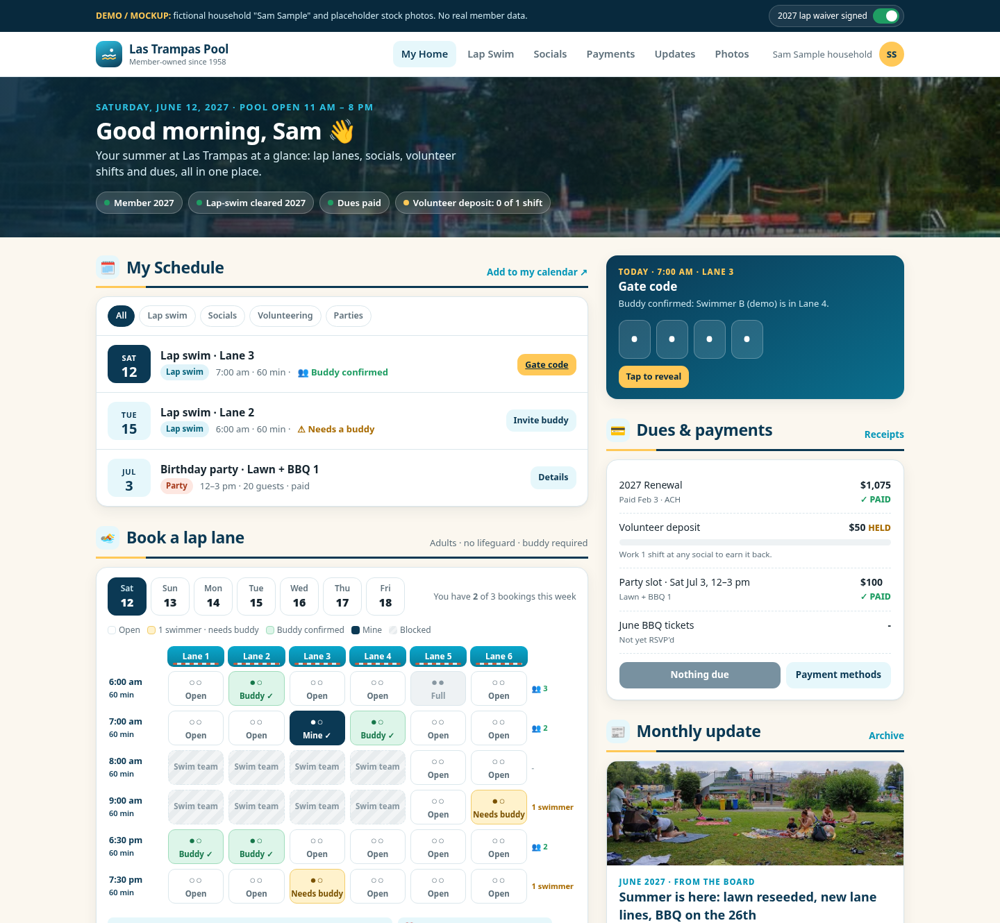
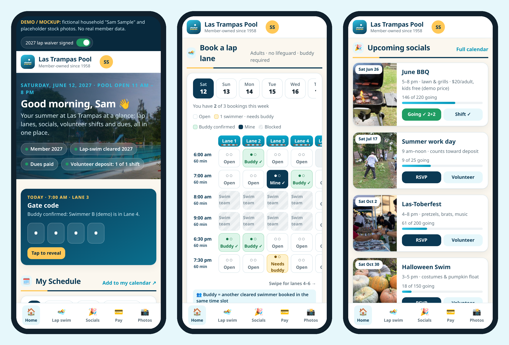

# Las Trampas Pool: Website v2 Plan

*Draft for the board · prepared for Gene Maggio · October 2026 · target: MVP live before the May 2027 opening*

> **Status note (added Oct 2026):** This plan's platform recommendation (stay on Membership Toolkit for 2027, decide on custom for 2028) is **superseded** by [ADR 0001: Custom platform](../decisions/0001-custom-platform.md). The vision, access tiers, journeys, admin features, migration table and open questions still apply. The PDF is the original, unedited version.

---

## 1. Vision

**One club, one login, one place.** A member opens lastrampaspool.com (or the app) and sees **their summer** at a glance:

- the lap lanes they've booked and who their buddy is
- the socials they've RSVP'd to and the volunteer shifts they've signed up for
- what they owe, and whether their volunteer deposit is earned back
- this month's update and the latest photos from the deck

The public sees a warm, photo-led site that sells the club to prospective families and the waitlist.

**Design principles (Gene's preferences):**

- **Real photos** of our pool, lawn and events, not vector illustrations
- **Prominent section headers** with clear visual separation (cards, bands, generous spacing)
- **Mobile-first**, because most members will use it on the pool deck. Still roomy on desktop
- **Volunteer-maintainable**: every recurring task (posting an update, adding an event, uploading photos) must be possible without code

---

## 2. Access tiers

One account per person, linked to a household. The tier is computed from membership status, the waiver for the season, and board role. **It's the same login everywhere.**

| Tier | Who | Can see / do |
|---|---|---|
| **Public** | Anyone | Home, About & History, Membership & Join/Waitlist, public event teaser, swim team & lessons links, Contact |
| **Member** | Adults and teens in a household with paid dues for the season | Everything public, plus My Schedule, socials RSVP, volunteer shifts, payments & dues, directory, monthly updates archive, photo gallery, handbook & bylaws, party reservations |
| **Lap-swim cleared** | A Member **with a signed lap-swim waiver for the current season** (adults; teen 15–17 terms are an open question) | Everything Member, plus the lap lane booking grid, buddy visibility, and the **gate code** (shown only for a confirmed booking) |
| **Board / admin** | Board members & delegated volunteers (role per area) | Admin console: events & slots, waiver status, attendance, volunteer credit, newsletter/updates posting, photo uploads, member records, reports |

Rules of thumb:

- The waiver resets every season.
- Lap-swim-only memberships ($525, invite-only) get Member + Lap-cleared, but no party reservations. (Board to confirm.)
- Admin rights are scoped (Social chair, Lap swim VP, Treasurer, Webmaster), not all-or-nothing.

---

## 3. Sitemap (v2)

```
PUBLIC                              MEMBER (login)                              ADMIN (board roles)
├─ Home                             ├─ My Home  ← dashboard                     ├─ Events & slots
├─ About                            │   ├─ My Schedule                          ├─ Lap swim: lanes, rules, blocks
│   ├─ History (since 1958)         │   ├─ Dues & payments card                 ├─ Waiver status (season)
│   ├─ Board & contacts             │   ├─ Monthly update card                  ├─ Attendance / check-in
│   └─ Facilities & map             │   └─ Photo strip                          ├─ Volunteer credit & refunds
├─ Membership                       ├─ Lap Swim  [Lap-cleared]                  ├─ Updates & newsletter
│   ├─ Join / Waitlist ($100)       │   ├─ Waiver (once per season)             ├─ Photos (upload, approve)
│   ├─ Renewal info                 │   ├─ Book a lane (grid)                   ├─ Members & households
│   └─ FAQ                          │   ├─ My bookings & buddy                  └─ Reports & exports
├─ Events (public teaser)           │   └─ Gate code (when confirmed)
├─ Programs                         ├─ Socials & Volunteering
│   ├─ Swim Team → ltst.org         │   ├─ RSVP + tickets
│   ├─ Lessons → ltst.org           │   └─ Volunteer shifts (deposit credit)
│   └─ Spiritwear → Elsmore Swim    ├─ Party Reservations ($100/slot)
└─ Contact                          ├─ Payments & Dues (history, receipts)
                                    ├─ Updates (monthly archive)
                                    ├─ Photos (albums by event)
                                    ├─ Directory
                                    ├─ Handbook & Bylaws
                                    └─ My Account (household, notifications)
```

**What changes from today:**

- The broken `/events` link and the empty Programs/About pages become real content.
- Lap swim moves **inside** the member area. No SignUpGenius, no second login.
- Newsletters get an **archive**.
- Bylaws and the handbook are hosted on-site (member-only).
- Board emails are unified on one role-address scheme.

---

## 4. Key user journeys

### 4.1 Lap swim: login → waiver once → book with buddy → gate code

1. **Log in** with the normal member login.
2. On the first lap-swim visit of the season, the member sees a **"Get cleared for lap swim" card**. They read the rules (adults only, no lifeguard, buddy required, no swimming alone), then **e-sign the waiver**. Their status flips to **Lap-cleared 2027** right away. No more emailing the VP.
3. **Book a lane.** The grid shows lanes 1–6 × time slots. Each cell shows:
   - **Open**
   - **1 booked: needs buddy** (amber)
   - **Buddy confirmed** (green), when two or more cleared swimmers are booked in the same slot
   - **Blocked** (swim team, lessons, maintenance)
   - **Mine**
4. **Booking limits** (board-set) apply, e.g. 3 slots/week, cancel by 9 pm the night before. The member can **invite a buddy** from cleared swimmers who've opted in to being visible.
5. **Day-of:** My Schedule shows the booking. The **gate code appears only** when the booking is today, the buddy rule is met, and the waiver is valid. If the buddy cancels, the member is notified and the code is hidden with a "find a buddy" prompt.
6. **After the swim:** an optional one-tap check-in creates the attendance record (the safety log).

### 4.2 Social: RSVP + volunteer shift + payment

1. **Upcoming socials** (Opening Party, June/July BBQ, Las-Toberfest, Halloween swim, maintenance days) show as photo cards.
2. **RSVP** asks for the number of adults and kids, and supports capacity and a waitlist.
3. **Paid events:** the RSVP goes through Stripe/ACH checkout. Free events are one tap.
4. **"Help out?"** offers shifts on the same card (setup, grill, cleanup), with capacity per shift.
5. **Volunteer credit:** a completed shift (marked by the shift lead or by check-in) counts toward the **$50 volunteer deposit**. The member sees "Deposit: earned back ✓". The treasurer gets a refund report.
6. Everything lands in **My Schedule**, with an add-to-calendar (ICS) option.

### 4.3 My Schedule

- A single, date-ordered list: lap bookings (with buddy status), RSVP'd socials, volunteer shifts, and party reservations.
- Filters by type. "This week" by default.
- A personal **ICS feed** for Google/Apple calendars.
- Reminders by email or push the day before (member chooses).

### 4.4 Payments & dues

- A **dues card** with season status: renewal **$1,075 + $50 volunteer deposit** (due Feb 16; $1,175 after), new member $675, lap-swim-only $525, waitlist $100, party slot $100.
- Pay by **ACH (encouraged, lowest fee)** or card. Payment plans if the board allows.
- Receipts and household payment history. Deposit status is tied to volunteer credit.

### 4.5 Photos

- Albums per event and season. Members can upload, and a board role approves before publishing.
- Member-only by default, with a public "best of" album for the home page.
- A **photo policy** (consent, no identifiable kids on public pages without opt-in) is in the open questions.

### 4.6 Monthly updates

- The board posts **one monthly update** (May–Oct, plus an off-season note) with a hero photo and sections.
- It's emailed to members and archived on the site.
- The home dashboard shows the latest update card.


### 4.7 Member home mockup

The clickable mockup is [`design/mockup/03_member_home_mockup.html`](../../design/mockup/03_member_home_mockup.html), with fictional data. The desktop view is above the fold. Phone views show home with the gate code, the lane booking grid, and socials with RSVP/volunteer.





---

## 5. Admin features

| Area | What admins can do |
|---|---|
| **Events & slots** | Create an event once with title, photo, date, capacity, price, RSVP fields and volunteer shifts. Clone last year's events. Create recurring lap-swim templates (lanes × times × days), with blocks for swim team, lessons and maintenance. |
| **Waiver status** | Season roster: signed, pending or expired. Waiver version history. Export a signed PDF. Revoke (e.g., a rule violation). |
| **Attendance** | Lap check-ins by date. Event RSVP vs. actual. No-show tracking. |
| **Volunteer credit** | Shifts completed per household. Deposit earned/forfeited. Treasurer refund export. |
| **Updates & newsletter** | Rich editor with photo blocks. Schedule a send. Archive automatically. |
| **Photos** | Bulk upload from a phone. Approval queue. Album management. |
| **Members** | Households, adults and teens, membership type, dues status, directory visibility. |
| **Reports & exports** | CSV of everything. Season summary for the annual meeting. |

---

## 6. Data migration (from MT and SignUpGenius)

| Data | From | How | Notes |
|---|---|---|---|
| Households, members, contact info, membership type/status | MT | Excel/CSV export of membership records and directory | 216 households. Dedupe emails. Map adults and teens |
| Payment history (current season) | MT accounting/orders reports | CSV export | Keep MT read-only through the end of 2026 for receipts |
| 2026 lap waivers (signed) | MT data form submissions | Export responses and keep PDFs | New waiver required for 2027 anyway |
| Lap bookings | SignUpGenius | Export (if the plan allows) or archive | Only needed for history |
| Newsletters | MT email tool | Copy the last ~2 seasons into the archive | Manual. Low volume |
| Calendar | MT calendar / ICS | Re-create 2027 events | Use templates |
| Bylaws / handbook | Google Docs | Export to PDF or page | Members-only |
| Photos | Facebook/Instagram, board drives | Curated upload | With consent |

If v2 is built **inside MT** (recommended for 2027), migration is limited to SignUpGenius and Google Docs. Everything else is reconfiguration.

---

## 7. Phased rollout

| Phase | When | Scope |
|---|---|---|
| **0. Decide** | Oct–Dec 2026 | Board review of this plan. MT support ticket on the four open capabilities. Confirm processor and fees. Member Splash demo as a benchmark. Pick the 2027 platform path. |
| **1. MVP** | Jan–Apr 2027 (soft launch Apr 15) | v2 navigation and home page with real photos. Member home (schedule, dues, update, photos). **Lap swim inside the member login** with a season waiver, lane grid, buddy visibility, and gate code behind the waiver. Social RSVP + volunteer shifts for the Opening Party and June BBQ. Newsletter archive. Fixes for broken links and empty pages. |
| **2. Season** | May–Jul 2027 | Volunteer credit → deposit report. Photo albums with an approval queue. Attendance/check-in. Booking-limit tuning from real use. |
| **3. Review** | Sep–Oct 2027 | Member survey + usage data. Decide whether to stay on MT, move to a swim-club platform, or build custom for 2028. Document the admin runbook for the board handoff. |

---

## 8. Open questions for the board

1. **Buddy rule:** must the buddy be in the **same lane**, or just on deck during the same slot? Can a non-swimming adult be a buddy?
2. **Teens 15–17:** the current waiver mentions teen terms, but lap swim is "adults only". What's the policy?
3. **Booking limits:** how many slots per week per person? Cancellation cutoff? What about no-shows?
4. **Lap hours & blocks:** which hours each day, and which are blocked for swim team, lessons or maintenance?
5. **Gate code:** keep one shared seasonal code, or rotate it (weekly/monthly)? Who can see it, and when?
6. **Volunteer deposit:** how many shifts or hours earn back the $50? Which events count? Is a refund or credit applied to next year?
7. **Payments:** which processor is the club using now, and who pays the fees? Can we steer members to ACH?
8. **Photos:** consent and kids-on-public-pages policy. Who approves uploads?
9. **Directory privacy:** what's visible to all members by default?
10. **Maintainer & handoff:** who besides Gene can administer the site? What's the annual board transition process?
11. **Budget:** is the club willing to spend more than today's MT cost (e.g., $2,000/yr for a swim-club platform) if it removes volunteer workload?

---

*Photos in this draft are stock placeholders from Wikimedia Commons (see `design/mockup/PLACEHOLDER_PHOTO_CREDITS.md`; stock files are not committed to this repo). The final site should use real Las Trampas photos.*
